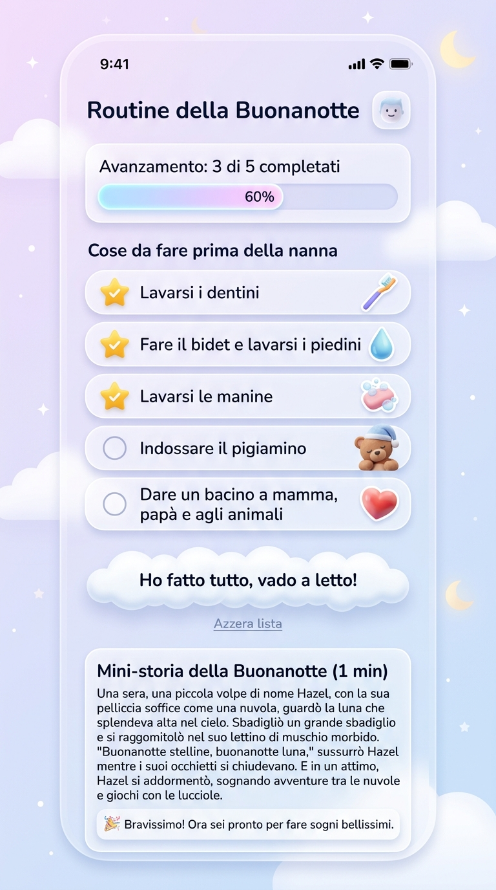

# Design Grafico ad Alta Fedeltà: "Routine della Buonanotte"

---

## 🎨 Sistema di Design & Palette Cromatica

Il design adotta un **mood magico, soffice e rilassante**, ideale per la fascia oraria serale e per i bambini.

| Elemento | Valore / Token | Descrizione |
| :--- | :--- | :--- |
| **Sfondo (Top)** | `#F3E9F9` | Lilla chiarissimo pastello da sogno |
| **Sfondo (Bottom)** | `#E8ECF8` | Azzurro polvere tenue e rasserenante |
| **Testo Principale** | `#2C3E50` | Blu notte profondo ad alta leggibilità |
| **Testo Secondario** | `#677A91` | Grigio-blu ardesia morbido |
| **Completati** | `#8D9FAF` | Testo barrato attenuato |
| **Accento Oro / Stelle** | `#FFB92D` / `#FFD568` | Oro caldo con alone luminoso per le checkbox spuntate |
| **Superfici Card** | `rgba(255, 255, 255, 0.68)` | Glassmorphism con `backdrop-filter: blur(20px)` |
| **Bordi Card** | `1.5px solid rgba(255, 255, 255, 0.85)` | Riflesso luminoso superiore (glossy rim) |
| **Ombre 3D** | `0 14px 34px -8px rgba(122, 140, 185, 0.2)` | Ombra fluttuante tridimensionale morbida |
| **Tipografia** | Google Font **Nunito** (400, 600, 700, 800, 900) | Carattere tondo, caldo e giocoso |

---

## 📱 Struttura Visiva degli Elementi (Dall'alto verso il basso)

1. **Header**:
   - Titolo: **«Routine della Buonanotte»** in grassetto blu notte (#2C3E50) con etichetta superiore *"Rituale serale ✨"*.
   - Destra: Pulsante profilo in vetro frosted con avatar bimbo ed indicatore audio ninna nanna.

2. **Card di Avanzamento (Glassmorphism)**:
   - Testo: **«Avanzamento: 3 di 5 completati»** con badge percentuale `60%`.
   - Barra di progresso a pillola con traccia semitrasparente e riempimento gradiente dal lavanda all'oro solare con indicatore a stella luminosa.
   - Sottotitolo poetico: *"Passo dopo passo verso il riposo"*.

3. **Sezione "Cose da fare prima della nanna"** (5 card a pillola con sticker 3D):
   - 🦷 **Lavarsi i dentini** — Checkbox tonda dorata spuntata con stella luminosa + sticker 3D spazzolino con dentifricio.
   - 💧 **Fare il bidet e lavarsi i piedini** — Checkbox tonda dorata spuntata + sticker 3D goccia d'acqua scintillante.
   - 🫧 **Lavarsi le manine** — Checkbox tonda dorata spuntata + sticker 3D bolle di sapone iridescenti.
   - 🧸 **Indossare il pigiamino** — Checkbox circolare vuota morbida + sticker 3D orsetto con berretto da notte.
   - 💖 **Dare un bacino a mamma, papà e agli animali** — Checkbox circolare vuota + sticker 3D cuoricino con stelline.

4. **Pulsanti d'Azione**:
   - **Pulsante principale a forma di nuvola (Cloud CTA)**: Forma sagomata a nuvola bianca tridimensionale con effetto fluttuante, icona luna/letto dorata e testo **«Ho fatto tutto, vado a letto!»**.
   - **Pulsante secondario**: Icona circolare e link elegante **«Azzera lista»**.

5. **Card Finale della Storia (in fondo)**:
   - Header con badge libro: **«Mini-storia della Buonanotte (1 min)»** e luna dorata fluttuante.
   - Testo della fiaba: *«C'era una volta una piccola volpe di nome Nocciola che guardava le stelle brillare nel cielo d'argento. S'addormentò presto, sognando di volare oltre le nuvole!»*
   - Box di celebrazione dorato: **«Bravissimo! Ora sei pronto per fare sogni bellissimi.»**

---

## 📂 File del Progetto

- [index.html](index.html) — Applicazione web e schermata interattiva ad alta fedeltà completa di suoni ninna nanna Web Audio e particelle celesti.
- [design_preview.jpg](design_preview.jpg) — Mockup grafico ad alta risoluzione della schermata.
